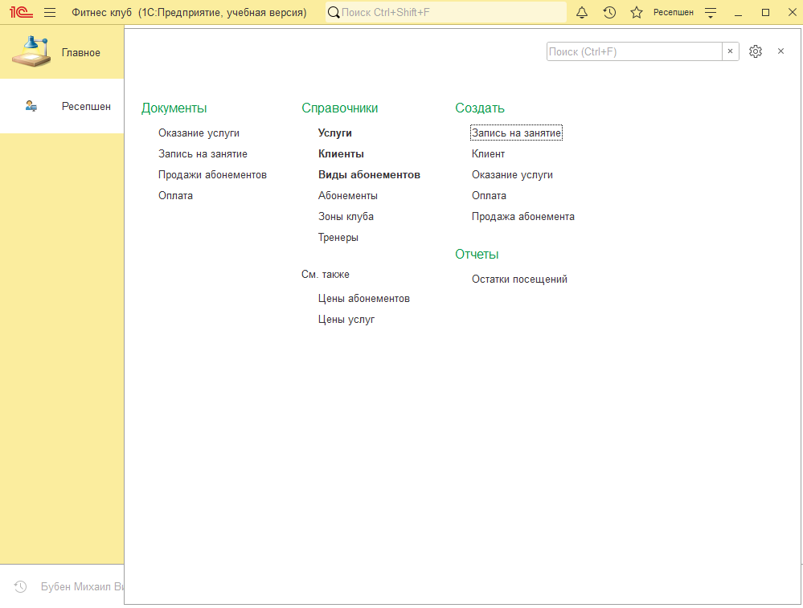
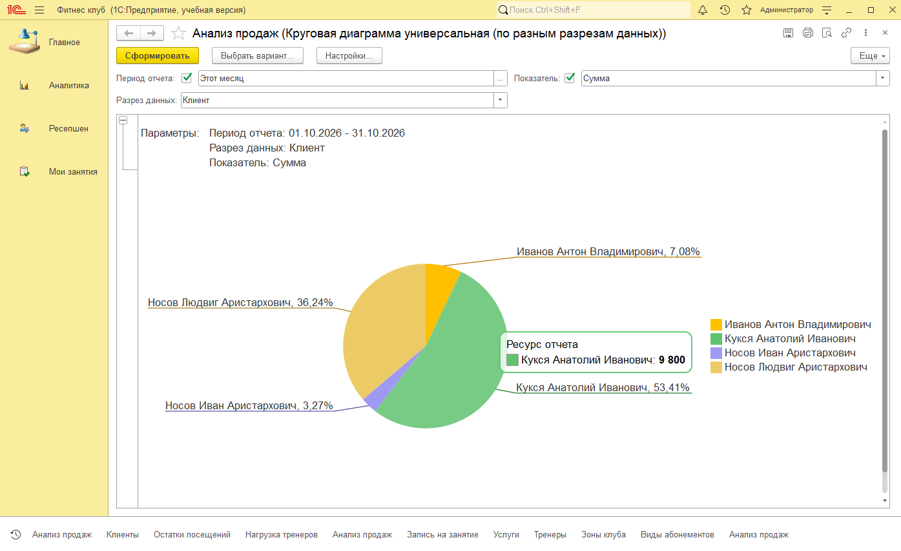
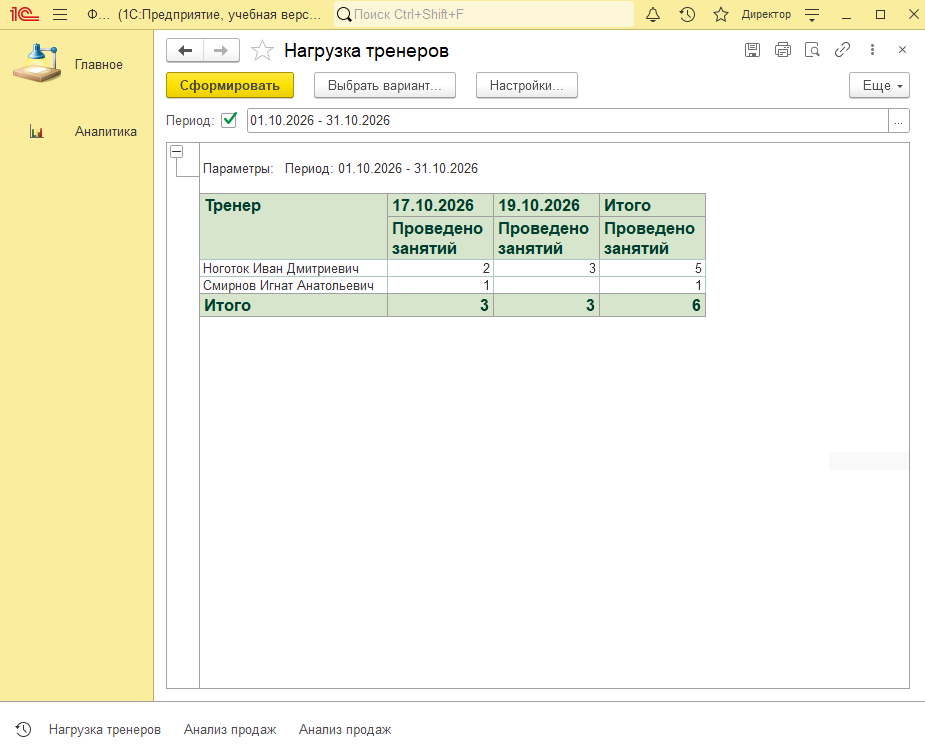

# Учебная конфигурация «Фитнес-клуб» (1С:Предприятие 8)

Проект представляет собой минимально жизнеспособную систему (MVP) для автоматизации учета продаж абонементов и оказанных услуг небольшого фитнес-клуба.

## Стек и среда разработки
- Платформа: 1С:Предприятие 8.5 (режим совместимости 8.3.27).
- Среда разработки: Конфигуратор (не EDT).
- Контроль версий: Git.
- БСП не используется.

## Структура проекта

### Метаданные
- Справочники: Клиенты, Услуги, Тренеры, ЗоныКлуба, ВидыАбонементов, Абонементы.
- Документы: ПродажаАбонемента, ЗаписьНаЗанятие, ОказаниеУслуги, Оплата.
- Регистры накопления: ОстаткиПосещений (контроль списаний по абонементам), Продажи (учет выручки).
- Регистры сведений: ЦеныУслуг, ЦеныАбонементов.
- Отчеты: АнализПродаж, НагрузкаТренеров, ОстаткиПосещений.

### Особенности реализации
- Списание посещений по небезлимитным абонементам: 1 документ списывает по 1 посещению с каждого задействованного абонемента.
- Контроль срока действия абонемента и доступных зон клуба при проведении.
- Автоматическая подстановка актуальных цен из регистра.
- Автоматическое создание/обновление карточки абонемента при продаже абонемента.
- Ввод на основании: Запись -> Оказание, Продажа/Оказание -> Оплата.
- Запрет распроведения продажи абонемента, если по нему уже были списания.

### Отчеты на СКД
- Анализ продаж: варианты в виде таблицы (с расшифровкой по иерархии) и интерактивной круговой диаграммы (с выбором разреза данных и показателя: сумма/количество).
- Остатки посещений: отчет с фильтрацией по клиенту.
- Нагрузка тренеров: кросс-таблица с подсчетом количества проведенных занятий по дням/месяцам.

### Права доступа и RLS
- Роли: Администратор, Ресепшен, Директор, Тренер.
- Интерфейс: настроены подсистемы (разделы) под каждую роль.
- RLS: для роли Тренер настроено ограничение доступа на уровне записей. Каждый тренер видит только свои занятия и свою нагрузку.

## Скриншоты

### Интерфейс раздела Ресепшена

### Отчет "Анализ продаж" (диаграмма)

### Отчет "Нагрузка тренеров"

## Известные ограничения
1. Продажа товаров - вне рамок проекта.
2. Цены устанавливаются через регистр вручную.
3. Оплата моментальная и полная, взаиморасчеты и долги не ведутся.
4. Слоты/расписание групповых занятий не реализованы.
5. В документе ОказаниеУслуги фильтр абонементов только по клиенту (остаток и срок отсекаются при проведении).

## Как развернуть
1. Скачайте репозиторий.
2. Создайте пустую информационную базу (файловую) в папке db/.
3. Откройте Конфигуратор и загрузите конфигурацию из папки src/ (Конфигурация -> Загрузить конфигурацию из файлов).
4. Обновите конфигурацию базы данных (F7) и запустите 1С:Предприятие (F5).